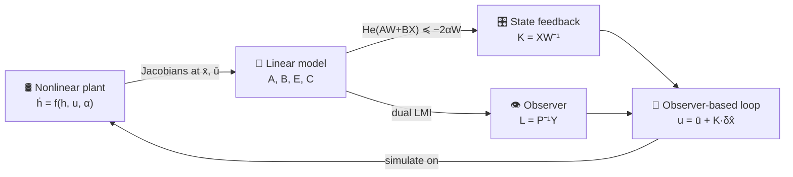
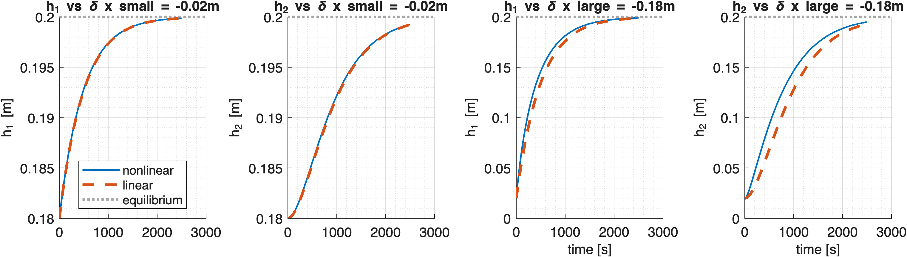
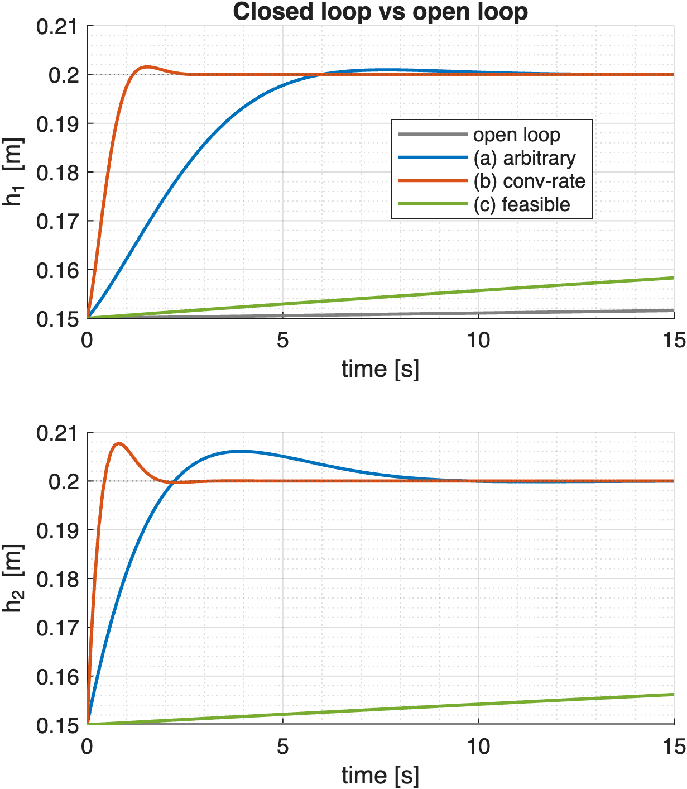
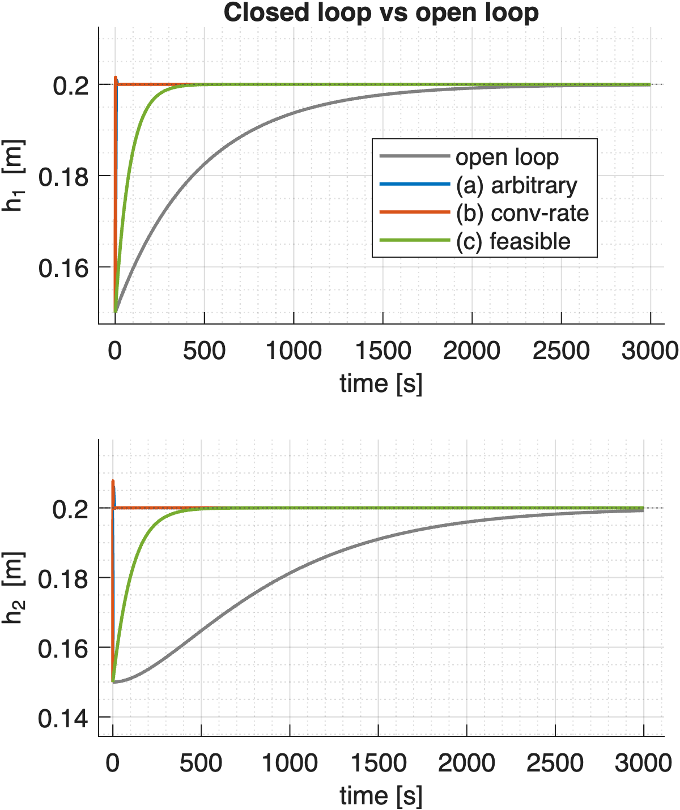
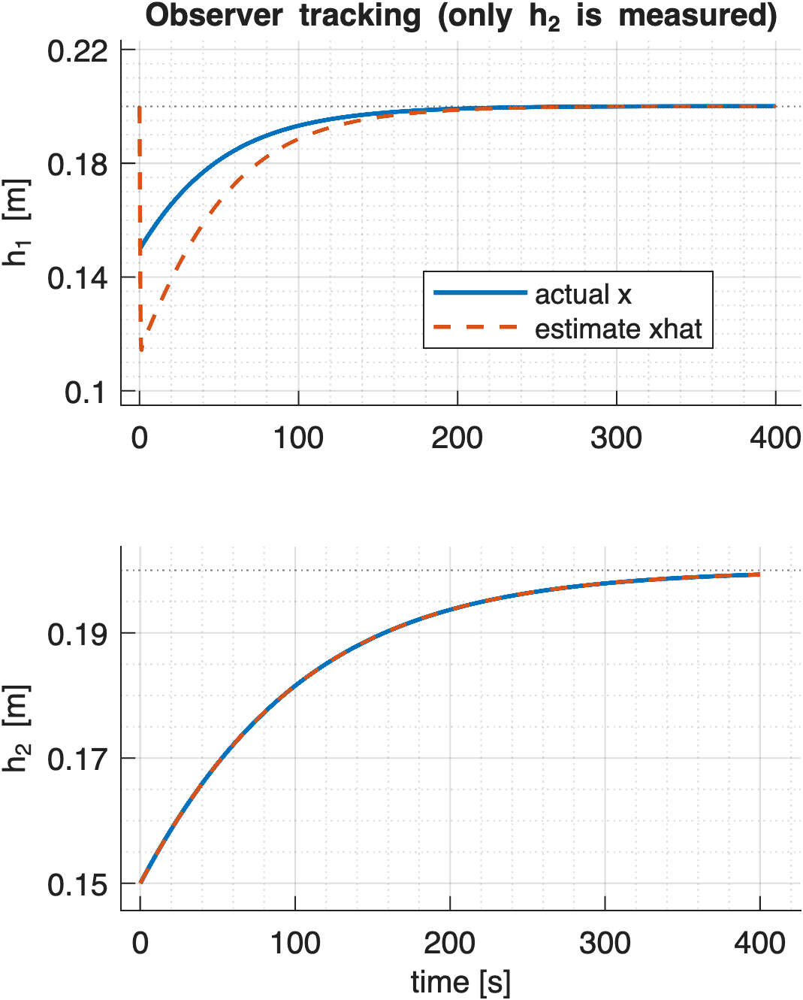
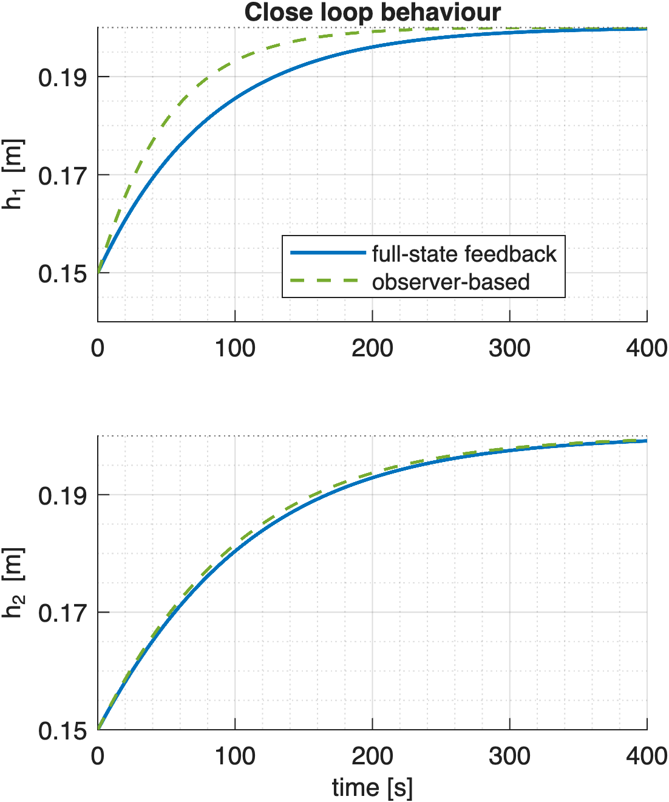

<div align="center">

# 🌊 Two-Tank LMI Control

**State-feedback and observer design for a nonlinear cascade of water tanks, done with Linear Matrix Inequalities.**

<sub>Automatic Control · Università di Trento · A.Y. 2025/2026</sub>

<br>


<br>

**[📄 Read the full report](Report_Victor%20Gabriele_De%20Matteis.pdf)** &nbsp;·&nbsp;
**[⚡ Quick start](#-quick-start)** &nbsp;·&nbsp;
**[📊 Results](#-results-at-a-glance)**

<br>



</div>

---

## ✨ What's inside

Two tanks in cascade: tank 1 drains into tank 2, three valves $u_1, u_2, u_3 \in [0,1]$ act as inputs, and two leaks $\alpha_1, \alpha_2$ act as disturbances. The open loop is stable but **slow**, with a ~495 s time constant. This project makes it faster without commanding a valve past fully open or fully shut, and it keeps working when one level sensor dies.

| | Stage | What happens |
|:-:|---|---|
| **①** | **Modelling & linearization** | Pick the operating point $\bar h_1=\bar h_2=0.2$ m by balancing actuator margins, derive $A, B, E$, and compare the linear and nonlinear responses |
| **②** | **State feedback via LMIs** | Three gains: arbitrary stabilizer $K_a$, guaranteed decay rate $K_b$, and minimum-gain $K_c$ that respects $u\in[0,1]$ |
| **③** | **Observer design** | Find out which sensor failure can be recovered from, then design a Luenberger observer by solving the dual LMI |
| **④** | **Observer-based feedback** | Close the loop on the estimate, then retune to $K_d$ so the commands stay feasible |



---

## 🧮 The core trick

The Lyapunov condition for the closed loop $A+BK$ is **bilinear** in $(P, K)$, so it can't be handed to a solver as is. Substituting $W = P^{-1}$ and $X = KW$ makes it linear:

```math
\underbrace{\mathrm{He}\big(P(A+BK)\big) \prec 0}_{\text{nonconvex}}
\quad\Longrightarrow\quad
\underbrace{W \succ 0,\;\; \mathrm{He}(AW + BX) \preceq -2\alpha W}_{\text{LMI in } (W,\,X)}
\quad\Longrightarrow\quad
K = XW^{-1}
```

To keep the actuators within bounds, `K_c` also minimizes a gain bound $\kappa$ via a Schur complement:

```math
\min_{W,X,\kappa}\; \kappa \quad \text{s.t.} \quad W \succ I,\quad \mathrm{He}(AW+BX)\preceq -2\alpha W,\quad
\begin{bmatrix}\kappa I & X^\top \\ X & \kappa I\end{bmatrix} \succ 0
\;\;\Rightarrow\;\; \|K\| \le \kappa
```

The observer is the same problem transposed: $`(A,\,B) \to (A^\top,\,C^\top)`$.

---

## 📊 Results at a glance

### Linearization (free response under $\bar u$)



<sub>The linearization is accurate near 0.2 m. Further away, the concave √h outflow makes the nonlinear plant fill faster. The peak error grows from 2.5·10⁻⁴ m to 2·10⁻² m.</sub>

### State feedback (nonlinear plant, $\delta x_0 = -0.05$ m)

| Controller | Settling time $t_s$ | $u_{\max}$ | $u_{\min}$ | Feasible? |
|---|--:|--:|--:|:-:|
| Open loop | 2840 s | 0.660 | 0.320 | ✅ |
| $K_a$ · arbitrary | 8 s | 38.06 | −1.323 | ❌ |
| $K_b$ · rate $\alpha=2$ | 2 s | 178.99 | −4.896 | ❌ |
| **$K_c$ · min-gain** | **385 s** | **0.868** | **0.012** | ✅ |

> [!TIP]
> $K_b$ is fastest on paper, but it asks for a valve opening of **179×** fully open. $K_c$ is the one you could actually build: it settles **~7× faster than open loop** and keeps every command inside $[0,1]$.

<table>
<tr>
<td width="50%"></td>
<td width="50%"></td>
</tr>
<tr>
<td align="center"><sub>0–15 s: <code>K_a</code>, <code>K_b</code> overshoot fast</sub></td>
<td align="center"><sub>0–3000 s: <code>K_c</code> settles in ≈385 s vs 2840 s</sub></td>
</tr>
</table>

### Sensor failure & observer

Because of the cascade, $A$ is lower-triangular, so **only the $h_2$ sensor matters**:

| Failed sensor | Remaining $C$ | $`\mathrm{rank}\,\mathcal{O}`$ | Recoverable? |
|---|---|:-:|:-:|
| $h_1$ | $`[0\;\;1]`$ | 2 | ✅ |
| $h_2$ | $`[1\;\;0]`$ | 1 | ❌ |

The observer poles sit at **−3.254**, roughly 280× faster than the controller poles at −0.0115. By the separation principle, the closed-loop spectrum is the union of the two sets.

| Loop | $t_{s,h_1}$ | $t_{s,h_2}$ | $u_{\max}$ | $u_{\min}$ | Feasible? |
|---|--:|--:|--:|--:|:-:|
| Full-state ($K_c$) | 303 s | 385 s | 0.868 | 0.012 | ✅ |
| Observer-based ($K_c$) | 192 s | 367 s | 0.965 | −0.094 | ❌ |
| **Observer-based ($K_d$)** | **255 s** | **453 s** | **0.891** | **0.004** | ✅ |

<table>
<tr>
<td width="50%"></td>
<td width="50%"></td>
</tr>
<tr>
<td align="center"><sub>Estimating <code>h₁</code> from <code>h₂</code> alone</sub></td>
<td align="center"><sub>Full-state vs observer-based closed loop</sub></td>
</tr>
</table>

---

## ⚡ Quick start

**Requirements:** MATLAB, [YALMIP](https://yalmip.github.io/), and [MOSEK](https://www.mosek.com/) (free academic license), all on the MATLAB path.

```matlab
>> q1_lin          % linearize, eigen-analysis, linear vs nonlinear
>> q2_feedback     % design K_a, K_b, K_c and compare on the nonlinear plant
>> q3_observer     % observability check, observer L, observer-based loop
```

Each script calls `startup_project` and `load_params` itself, so you can run them in any order. Two helper scripts back up the design choices: `find_u2` (operating-point sweep) and `decompose_h2` (linearization-error channels).

> [!NOTE]
> Every run is **snapshotted** to `results/<timestamp><tag>/` with a copy of the exact config JSONs, a `run.mat` with the gains and tables, and every figure as `.fig` and 300-dpi `.png`. Each result can be traced back to the parameters that produced it.

---

## 🗂️ Project layout

```
LMI_PROJECT/
├── q1_lin.m              ① modelling & linearization
├── q2_feedback.m         ② LMI state-feedback design (K_a, K_b, K_c)
├── q3_observer.m         ③④ observer + observer-based feedback (L, K_d)
├── find_u2.m             operating-point margin sweep
├── decompose_h2.m        inflow/outflow linearization-error split
├── startup_project.m     adds src/ to the path
│
├── config/               all tunables, no magic numbers in code
│   ├── plant_params.json   tank areas, orifices, pump flow, leaks
│   ├── equilibrium.json    h̄₁, h̄₂, ū₂
│   ├── design.json         α_b, α_c, α_obs, δx₀, solver verbosity
│   └── observer_gains.json K matrices used by the observer loop
│
├── src/
│   ├── model/            nonlinear dynamics, Jacobians, equilibrium solver
│   ├── sim/              linear / nonlinear / observer simulators, input builder
│   └── io/               config loader, run snapshotting, figure styling
│
└── report/               LaTeX source, figures, bibliography
```

---

## 🔧 Tuning

All design knobs live in [`config/design.json`](config/design.json):

| Key | Meaning | Value |
|---|---|--:|
| `alpha_b` | decay rate for $K_b$ | `2` |
| `alpha_c` | decay rate for $K_c$, tuned so $u\in[0,1]$ | `0.0115` |
| `alpha_obs` | observer decay rate | `2` |
| `dx0` | initial deviation $\delta x_0$ [m] | `[-0.05, -0.05]` |
| `gain_letter` | which stored $K$ the observer loop uses | `"c"` |

---

## 📚 References

- L. Zaccarian, A. Sferlazza, *Analysis and Synthesis of Feedback Systems: Quadratic Functions and LMIs*, lecture notes, Università di Trento.
- J. P. Hespanha, *Linear Systems Theory*, Princeton University Press, 2009.

<div align="center">
<br>
<sub>Made by <a href="https://github.com/ViDem02">@ViDem02</a> · Victor Gabriele De Matteis</sub>
</div>
